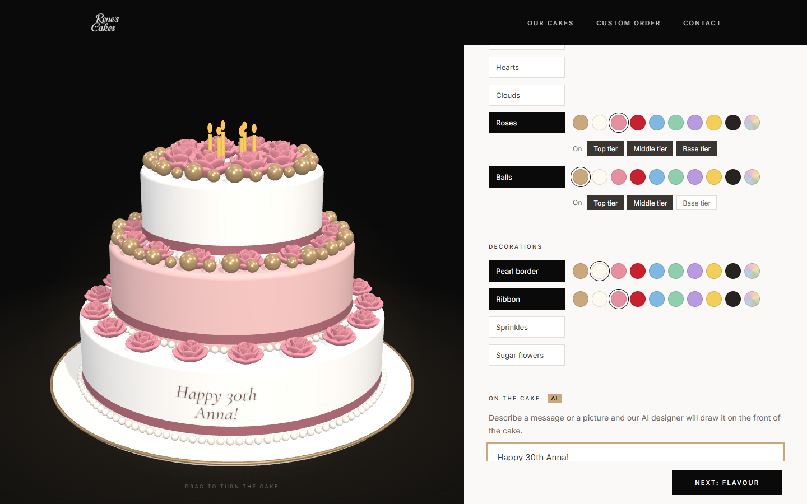
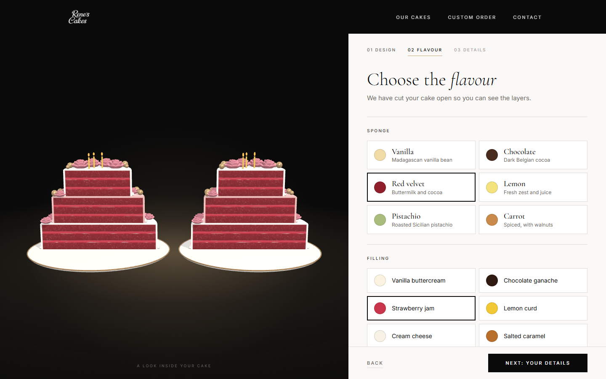
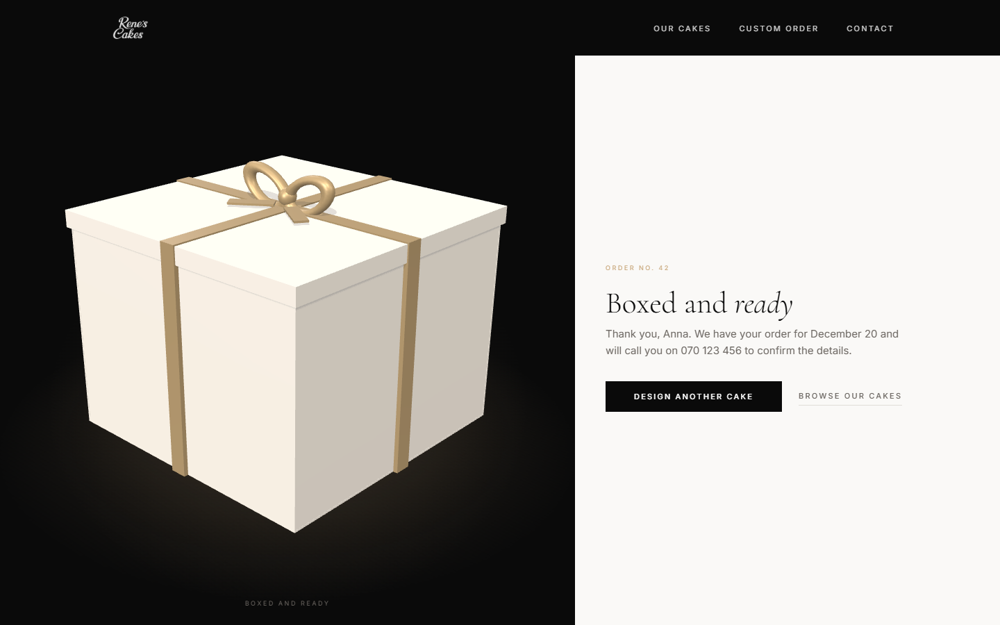
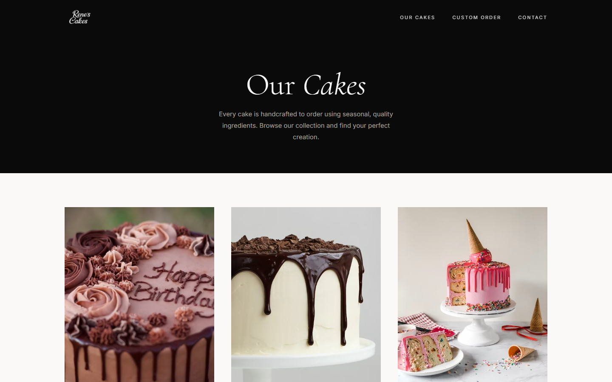

# Rene's Cakes

A full-stack website for a family cake business. Customers browse the cake catalogue, design their own cake in a live 3D builder, and place an order. An AI designer draws whatever the customer asks for (a message or a small picture) directly onto the 3D cake.

**Stack:** React 19 · TypeScript · three.js · Vite · Spring Boot 4 · Java 17 · PostgreSQL · Claude API



## Highlights

- **Interactive 3D cake builder** written directly in three.js, with no 3D library on top. Every option rebuilds the model instantly: 1 to 4 tiers, frosting colour per tier, toppings (candles, stars, hearts, clouds, roses, balls) on any combination of tiers, and decorations (pearl border, ribbon, sprinkles, sugar roses), each in a chosen colour.
- **Cut-open flavour step.** The cake splits in half to show its inside. Choosing a sponge and filling repaints the layers, which are drawn procedurally on a canvas texture.
- **AI cake designer.** The backend asks Claude to draw the customer's request as SVG. The frontend sanitises the SVG, rasterises it and wraps it around the front of the cake. If the AI is unavailable, the customer's words are piped on in icing lettering instead, so the feature never blocks an order.
- **Boxing animation** when the order is placed: the walls rise, the lid drops and the ribbon is tied.
- **Full design saved with the order** as structured JSON, so the bakery sees exactly what the customer built.
- **Tested REST API** with validation, consistent error responses and integration tests that run on an in-memory database.

| Cut open to choose the flavour | Boxed and ready after ordering |
|---|---|
|  |  |



## Architecture

```
┌─────────────────────────┐   JSON over HTTP   ┌──────────────────────────┐        ┌────────────┐
│  React + three.js SPA   │ ─────────────────▶ │  Spring Boot REST API    │ ─────▶ │ PostgreSQL │
│  (Vite, port 5173)      │                    │  (port 8080)             │        └────────────┘
└─────────────────────────┘                    │                          │        ┌────────────┐
                                               │  /api/ai/cake-art ───────┼──────▶ │ Claude API │
                                               └──────────────────────────┘        └────────────┘
```

- **Frontend** ([`frontend/`](frontend/)): React 19, TypeScript and React Router, with plain CSS. The 3D scene is a framework-agnostic `CakeScene` class that React drives through props. It is lazy-loaded, so three.js is only downloaded on the builder page.
- **Backend** ([`backend/`](backend/)): Spring Boot 4 with Spring Data JPA, Bean Validation and Spring Security. It is layered as controller → service → repository. The Claude API key stays on the server and is never sent to the browser.

## Running it locally

### Prerequisites

| Tool | Version |
|---|---|
| [Node.js](https://nodejs.org/) | 20.19 or newer |
| [Java JDK](https://adoptium.net/) | 17 or newer (Maven is included through the wrapper) |
| [Docker](https://www.docker.com/products/docker-desktop/) | Any recent version, for PostgreSQL |
| [Anthropic API key](https://console.anthropic.com/) | Optional, only for the AI designer |

### 1. Database

```bash
docker compose up -d
```

This starts PostgreSQL 16 on `localhost:5433` (database `cakes`, user `cakes_user`, password `cakes_pass`). The port is 5433 so it does not clash with a local PostgreSQL.

### 2. Backend

```bash
cd backend
export ANTHROPIC_API_KEY=your-key   # optional; PowerShell: $env:ANTHROPIC_API_KEY = "your-key"
./mvnw spring-boot:run               # Windows: .\mvnw.cmd spring-boot:run
```

The API runs on http://localhost:8080. Tables are created on startup, and the catalogue is filled with sample cakes the first time.

### 3. Frontend

```bash
cd frontend
npm install
npm run dev
```

Open http://localhost:5173. The cake builder is at http://localhost:5173/custom-order.

To use a different backend address, copy [`frontend/.env.example`](frontend/.env.example) to `frontend/.env.local` and change `VITE_API_URL`.

## API

| Method | Path | Description |
|---|---|---|
| `GET` | `/api/products` | List the cake catalogue |
| `GET` | `/api/products/{id}` | One cake, or `404` |
| `POST` | `/api/orders` | Place an order, returns `201` with the saved order |
| `POST` | `/api/ai/cake-art` | Turn a description into an SVG drawing for the cake |

These endpoints are public. Every other path requires authentication, reserved for the planned admin area.

Validation errors return `400` with the failing fields:

```json
{ "message": "Validation failed", "errors": { "phone": "must not be blank" } }
```

<details>
<summary>Example requests</summary>

```http
POST /api/orders
Content-Type: application/json

{
  "customerName": "Anna Smith",
  "phone": "070 123 456",
  "email": "anna@example.com",
  "pickupOrDelivery": "PICKUP",
  "dateNeeded": "2026-12-20",
  "notes": "No nuts please",
  "customizationJson": "{\"tiers\":3,\"sponge\":\"redvelvet\", ...}"
}
```

```http
POST /api/ai/cake-art
Content-Type: application/json

{ "prompt": "Happy 30th Anna, with little gold stars", "frostingColor": "#ffffff" }
```

The cake-art endpoint returns `{ "svg": "<svg ...>" }`. It answers `422` if the request is not suitable for a cake, `503` if the AI is not configured or unreachable, and `502` if the response is not a usable drawing.

</details>

## Tests and checks

```bash
cd backend && ./mvnw test      # API integration tests on an in-memory H2 database, no Docker needed
cd frontend && npm run lint    # ESLint
cd frontend && npm run build   # type-check and production build
```

The backend tests cover the catalogue, `404` handling, order creation, validation errors, the access rules, and that the seed data is not duplicated on restart. [GitHub Actions](.github/workflows/ci.yml) runs all three checks on every push and pull request.

## Project structure

```
frontend/src/
├── pages/                 One component per route
├── components/            Navbar, Footer, CakeCard, CakeGrid, LogoVideo
├── cake-builder/          The custom order feature
│   ├── scene/             three.js: CakeScene (model, cut-open and boxing animations), textures
│   ├── steps/             DesignStep, FlavourStep, DetailsStep, OrderComplete
│   ├── options.ts         Every option the customer can choose, and the defaults
│   ├── useCakeArt.ts      AI drawing state, with the icing-lettering fallback
│   └── order.ts           Turns the design and the form into the order request
├── hooks/                 useApi (data loading), useFadeIn (scroll reveal)
└── api.ts                 Typed client for the backend

backend/src/main/java/com/renescakes/backend/
├── controller/            REST endpoints
├── service/               Business logic, including CakeArtService (Claude)
├── repository/            Spring Data JPA repositories
├── model/                 JPA entities and enums
├── dto/                   Validated request bodies
├── config/                CORS, security and error handling
└── exception/             Custom exceptions
```

## Configuration

| Setting | Where | Default |
|---|---|---|
| Database connection | `backend/src/main/resources/application.properties` | The Docker database above |
| Claude model | `anthropic.model` in the same file | `claude-opus-5-5` |
| Claude API key | `ANTHROPIC_API_KEY` environment variable | Not set: the builder uses icing lettering instead |
| Allowed frontend origin (CORS) | `backend/.../config/WebConfig.java` | `http://localhost:5173` |
| Backend URL for the frontend | `VITE_API_URL` in `frontend/.env.local` | `http://localhost:8080` |

## Roadmap

- Admin dashboard: sign in, view orders with a 3D preview of the saved design, update order status, manage the catalogue
- Rate limiting on the AI endpoint before a public deployment
- Deployment with Docker images for the frontend and backend
